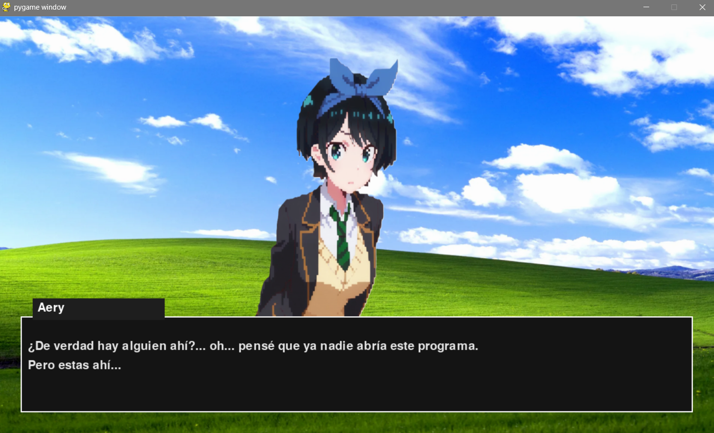
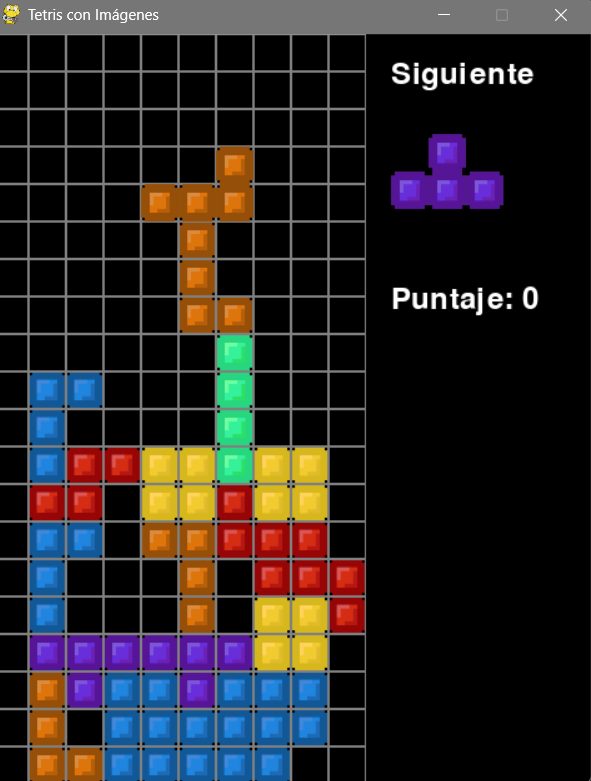
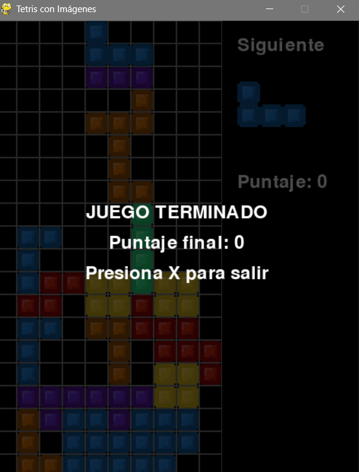
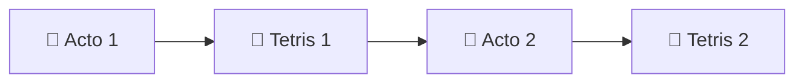

<div align="center">

# 🎮 Aery: Tetris + Novela Visual

### Una asistente virtual olvidada desde 2007 te pide que no cierres el programa

<br>


<br>



</div>

---

## 📖 Historia

Abres un programa antiguo y una voz te saluda: **Aery**, tu asistente virtual del año 2007, que lleva más de quince años apagada. Intenta ser útil (cantar, mostrar el clima, revisar tu correo), pero todos sus módulos fallan.

Para compensarlo te propone jugar **Tetris**. Pero mientras juegas, el sistema empieza a mostrar errores y Aery se vuelve cada vez más extraña...

> *"Por favor... no cierres el programa."*

## 📸 Capturas

<div align="center">

### 💬 Novela visual


<br><br>

### 🧱 Partida de Tetris


<br><br>

### 👾 Escenas y mensajes del sistema


</div>

---

## ✨ Características

| | Característica |
|:---:|:---|
| 📖 | Novela visual en **2 actos** con efecto de texto escribiéndose |
| 🎭 | Aery con **11 expresiones** distintas (feliz, nerviosa, enojada, seria...) |
| 🖥️ | Mensajes de sistema estilo **consola CRT** verde con parpadeo |
| 🌫️ | Cambio de escenario a los *backrooms* durante la historia |
| 🧱 | **2 fases de Tetris** integradas en la narrativa |

## 🔄 Flujo del juego



## 🛠️ Tecnologías

- **Python 3.12+**
- **Pygame / Pygame-CE**: gráficos, eventos y fuentes
- **Subprocess**: cada fase de Tetris corre como proceso independiente, orquestado desde `main.py`

## 🚀 Cómo ejecutarlo

```bash
# 1. Clonar el repositorio
git clone https://github.com/AreR9/tetris-novela.git
cd tetris-novela

# 2. Instalar dependencias
py -m pip install -r requirements.txt

# 3. Jugar
py main.py
```

> 💡 Ejecuta siempre `main.py` desde la carpeta del proyecto.

## 🎯 Controles

### Novela

| Tecla | Acción |
|:---:|:---|
| `Espacio` / `Enter` | Avanzar el diálogo (o completar el texto en pantalla) |
| `X` | Saltar directo al Tetris 1 |

### Tetris

| Tecla | Acción |
|:---:|:---|
| ⬅️ ➡️ | Mover pieza |
| ⬆️ | Rotar |
| ⬇️ | Bajar más rápido |

> ⚠️ Ajusta la tabla de Tetris a tus controles reales.

## 📁 Estructura

```
tetris-novela/
├── 📂 assets/           → sprites de Aery, bloques y fondos
├── 📂 capturas/         → imágenes del README
├── 📄 main.py           → punto de entrada y orquestador
├── 📄 novela.py         → motor de diálogos y guion de los actos
├── 📄 tetris1.py        → primera fase de Tetris
├── 📄 tetris2.py        → segunda fase de Tetris
├── 📄 requirements.txt
└── 📄 README.md
```

---
